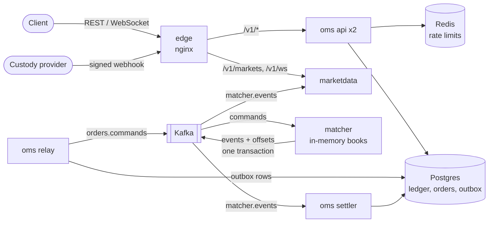

# Problem 1: Exchange (wave 1, local stack)

A small spot exchange (BTC-USDT, ETH-USDT) built to prove the hard parts of the P1
design before any cloud spend: money correctness, exactly-once settlement, crash recovery
and the p99 budget. Wave 2 maps the same services onto AWS.

## Architecture



| Component     | Role                                                 | Why                                                                    |
| ------------- | ---------------------------------------------------- | ---------------------------------------------------------------------- |
| `oms api`     | Auth, deposits, balances, order placement and cancel | One Postgres transaction per write: order + fund hold + outbox command |
| `oms relay`   | Outbox to Kafka, in commit order                     | A command reaches the matcher if and only if its order committed       |
| `matcher`     | Price-time priority books in memory                  | Deterministic; rebuilt by replaying the command log                    |
| `oms settler` | Kafka events to the ledger                           | One transaction per command, deduped by an inbox table                 |
| `marketdata`  | Depth, trades, 24h ticker, WebSocket                 | Read model rebuilt from events; scales with clients                    |
| Postgres      | Double-entry ledger                                  | Invariants enforced in the schema, not only in code                    |
| Kafka         | Ordered command and event logs                       | Per-symbol ordering, replay, exactly-once matcher output               |
| Redis         | Rate limits                                          | Shared across API replicas; falls back to memory if down               |
| nginx         | Local stand-in for CloudFront + ALB                  | Routing, per-IP backstop, uniform error format                         |

Decisions and trade-offs are in [docs/adr](docs/adr). Coding rules are in
[docs/CONVENTIONS.md](docs/CONVENTIONS.md).

## Run it

Requires Docker, GNU make and Node 22.19+ (`nvm use`).

```bash
npm ci
make up          # builds one image, starts 12 containers, waits until healthy
make help        # every target
```

The API is at `http://127.0.0.1:18080`. `make nuke` removes everything, including data.
How the stack, gates and telemetry fit together, as diagrams:
[docs/DEVELOPMENT.md](docs/DEVELOPMENT.md).

## Observability and SLOs

```bash
make up-obs      # the stack plus OTel Collector, node-exporter, Loki, Tempo, Mimir, Grafana
make slo         # SLO catalog from empty state: p95/p99, CPU and memory per service
```

- Grafana at `http://127.0.0.1:13000` has two dashboards, _SLO and order pipeline_ and
  _CPU and memory_, which also covers the Docker VM and the collector itself. Both are built by [deploy/grafana/dashboards.mjs](deploy/grafana/dashboards.mjs);
  edit it and run `make dashboards`.
- Services send traces and logs over OTLP to the collector, which also scrapes their
  `/metrics`, reads Docker stats and scrapes node-exporter for VM stall time. One trace
  follows an order from the API through Kafka to settlement.
- Scenarios, windows, sizes and objectives are in
  [tests/perf/slo/scenarios.json](tests/perf/slo/scenarios.json). The latest run is in
  [reports/slo/RESULTS.md](reports/slo/RESULTS.md), with every number also in `RESULTS.json`.
  How runs are kept comparable is in [docs/DEVELOPMENT.md](docs/DEVELOPMENT.md#7-slo-tests).

## Tests

| Suite             | Command                       | What it proves                                                                                                                                                  |
| ----------------- | ----------------------------- | --------------------------------------------------------------------------------------------------------------------------------------------------------------- |
| Unit and property | `make test`                   | Matching rules, fees, holds, settlement terms; fast-check proves the book never crosses, never overfills, never self-trades, and replays deterministically      |
| Contract          | `make test`, `make check-gen` | Every spec compiles in the validator; responses that break the spec fail; generated code matches `contracts/`                                                   |
| Integration       | `make test-integration`       | Use cases on real Postgres: redelivered batches settle once, concurrent orders cannot overdraw, unbalanced or edited journals are refused                       |
| E2E transactions  | `make e2e`                    | Full flow through edge, outbox, Kafka, matcher and settlement; exactly-once deposits under 25 concurrent duplicates; ledger invariants checked after every file |
| Chaos             | `make chaos`                  | Matcher restart rebuilds the book by replay; a settler SIGKILL mid-flow settles every trade exactly once                                                        |
| Abuse (pen test)  | `make security`               | IDOR, double spend, idempotency races, JWT forgery, credential guessing, X-Forwarded-For spoofing, injection, oversized input; then an OWASP ZAP API scan       |
| Load              | `make perf`                   | 500 rps open model; p99 < 100 ms per request                                                                                                                    |
| SLO catalog       | `make slo`                    | Seven scenarios, each with load, window, size and a p95/p99 objective, reported with CPU and memory per service, pipeline lag and VM stall time                 |

Run order matters only once: the abuse suite spends the per-IP auth budget on purpose,
and the helpers wait it out.

## Quality loop

Every change went through the same gates:

1. Evidence before the fix (for example `reports/security/before-xff-fix.txt`).
2. A test that fails without the change. Key ones were mutation-checked.
3. An independent read-only QA review against intended behaviour, re-run until no blockers.
4. A/B on the same k6 scenario, fresh stack per side: `make ab A=<sha> B=<sha>`.
5. Full stack verification before the commit.

## Results

See [reports/RESULTS.md](reports/RESULTS.md).

## Known limits (wave 1)

- One matcher instance; recovery is a cold replay of the full log. Snapshots and a
  hot standby are wave 2 (ADR 0003).
- Withdrawals, custody internals and API-key request signing are out of scope until P5.
- Local latency includes Docker Desktop disk fsync on every commit; see the results.
