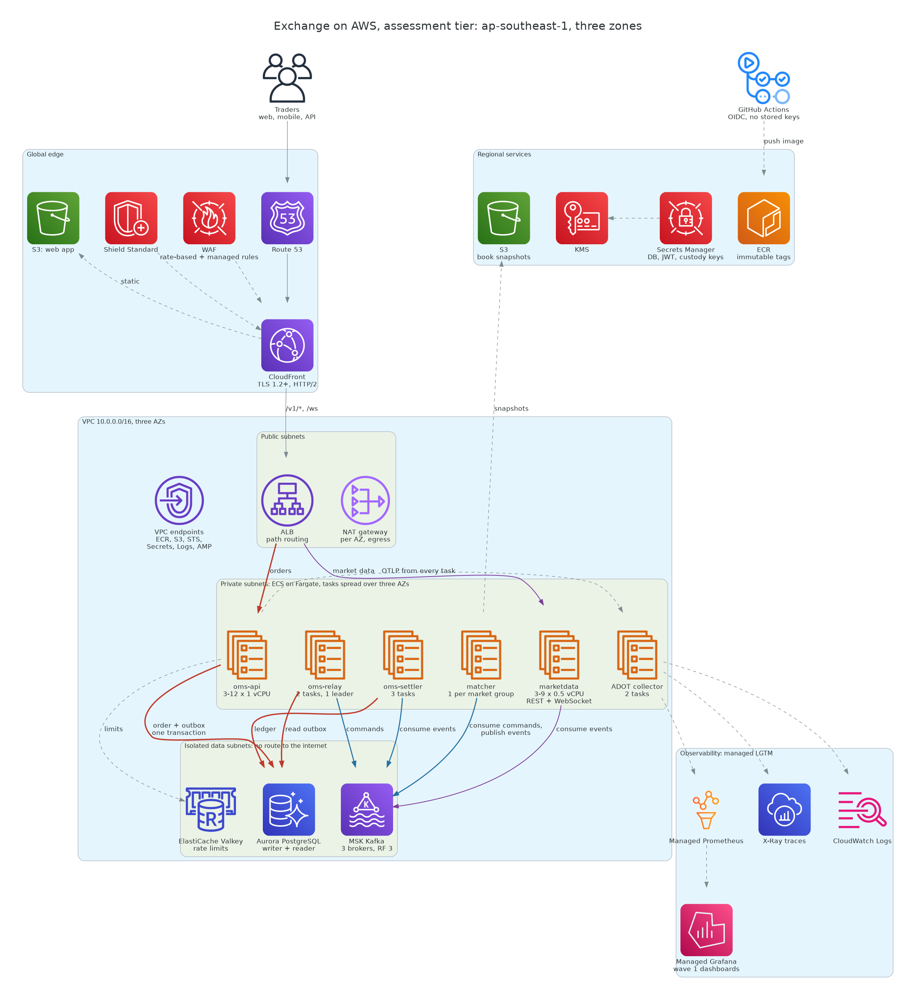
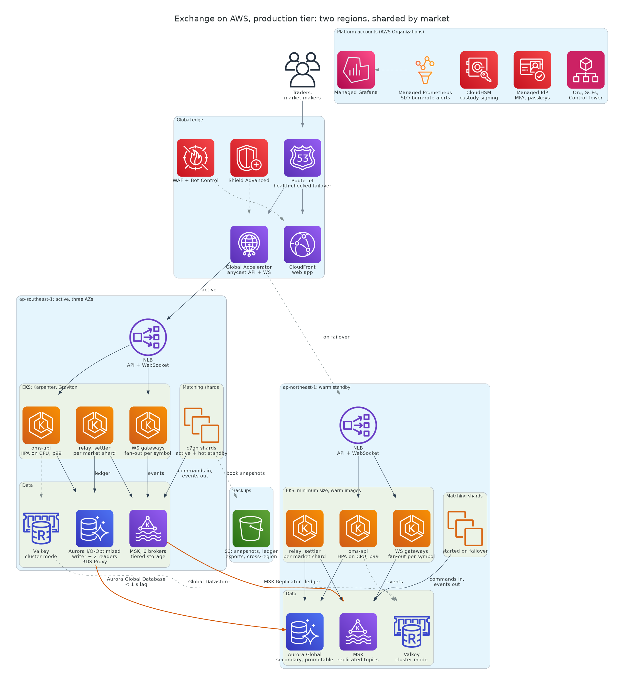

# Problem 1: Building Castle In The Cloud

A spot exchange with the core of Binance: accounts and balances, limit and market orders,
price-time matching, settlement into a double-entry ledger, and live market data.

- **Wave 1** built it and proved it locally: three services, a ledger, a matcher with
  recovery, and unit, contract, e2e, chaos, abuse and load tests
  ([README](README.md), [results](reports/RESULTS.md), [local design](docs/DEVELOPMENT.md)).
- **This document** lifts the same software onto AWS. Service boundaries, contracts and the
  recovery model carry over unchanged; only what runs underneath changes.

| Target | How the design meets it |
|---|---|
| 500 req/s, p99 < 100 ms | Sized from measured CPU per request; latency budget below leaves 40 ms of headroom |
| Survives an Availability Zone loss | Every tier runs in three zones; N+1 capacity; no single-zone component |
| Scales beyond the plan | Each tier has a named next step and the measurement that triggers it |
| Cost-effective | About $2.5k a month on demand; the biggest line items and their levers are listed |

## 1. The assessment tier on AWS

Red is the money path, blue the event log, purple market data, dashed lines operations. The
diagrams are code: [docs/aws/diagrams](docs/aws/diagrams), rendered by `make aws-diagrams`.

An order, end to end:

1. CloudFront terminates TLS near the trader, WAF filters it, and `/v1/*` goes to the ALB.
2. `oms-api` checks the token and rate limits (Valkey), then writes the order, the funds
   reservation and an outbox row in **one Aurora transaction**, and answers `NEW`.
3. `oms-relay` moves outbox rows to the `orders.commands` topic, keyed by symbol.
4. The `matcher` consumes commands, matches in memory, and publishes events and its consumer
   offset in one Kafka transaction (ADR 0003).
5. `oms-settler` turns events into ledger journals in Aurora. `marketdata` turns the same
   events into depth, trades and tickers for REST and WebSocket clients.

## 2. From docker compose to AWS

| Wave 1 (compose) | AWS | Change to the code |
|---|---|---|
| nginx edge: routing, `X-Forwarded-For` overwrite | CloudFront, WAF, ALB | Client IP from `CloudFront-Viewer-Address`. Trusting private proxies alone would make `req.ip` a CloudFront edge address, and every per-IP limit would key on edge servers |
| `oms-api` x2 | ECS service, 3 to 12 Fargate tasks | None |
| `oms-relay` | ECS service, 2 tasks; a Postgres advisory lock elects the leader | None |
| `oms-settler` | ECS service, 3 tasks in one Kafka consumer group | None |
| `matcher` | ECS service, 1 task per market group, fenced by `transactional.id` | Book snapshots to S3 (ADR 0003 follow-up) |
| `marketdata` | ECS service, 3 to 9 tasks behind the ALB, WebSocket included | None |
| Postgres 17 | Aurora PostgreSQL, writer and reader in two zones | `DATABASE_URL` with `sslmode=verify-full` |
| Kafka 4 (KRaft) | MSK, three brokers, replication factor 3 | TLS and SASL/SCRAM settings in the Kafka client |
| Redis 7 | ElastiCache for Valkey, primary and replica | `REDIS_URL` with TLS |
| `deploy/.secrets` files | Secrets Manager, injected by ECS as environment variables | None |
| OTel Collector, Loki, Tempo, Mimir, Grafana | ADOT Collector, CloudWatch Logs, X-Ray, Managed Prometheus, Managed Grafana | None. Same OTLP; dashboards come from the same generator |
| `make` and GitHub Actions | GitHub Actions with OIDC, ECR, ECS rolling deploys (the Problem 4 pattern) | None |

The image is already multi-stage and distroless, so it builds for Graviton (arm64) as is.

## 3. Platform tier: configured for the assessment scope

Sizes come from the wave 1 SLO run at 500 req/s ([reports/slo](reports/slo/RESULTS.md)).
A Fargate vCPU is assumed to do half the work of the laptop core those numbers came from.

| Component | Configuration | Sized from | Headroom |
|---|---|---|---|
| `oms-api` | 3 tasks x 1 vCPU, 2 GB, one per zone; scale to 12 at 50% CPU | 77% of a laptop core at 500 req/s | Each task ~50% at peak; a lost zone triggers scale-out |
| `marketdata` | 3 x 0.5 vCPU, 1 GB; scale on CPU and open connections | 33% at 500 req/s | ~45% per task |
| `oms-settler` | 3 x 0.5 vCPU, 1 GB | 24% | Serial per market: ~450 commands/s ceiling (measured) |
| `oms-relay` | 2 x 0.25 vCPU, 0.5 GB, one active | 9% | Standby takes the lock in seconds |
| `matcher` | 1 x 1 vCPU, 2 GB, all markets in one group | 15%, ~110 MiB | Split markets across tasks before 50% |
| ADOT Collector | 2 x 0.5 vCPU, 1 GB; 10% head sampling | 0% lost at 8,400 spans/s locally | Sampling cost measured in [OVERHEAD.md](reports/slo/OVERHEAD.md) |
| Aurora PostgreSQL | `db.r7g.large` writer + reader, Standard storage | 46% of a laptop core | ~45% of the writer's 2 vCPU; ~1,700 connections by default |
| MSK | 3 x `kafka.m7g.large`, RF 3, `min.insync.replicas` 2, 12 partitions per topic, 100 GB each | 55% of a laptop core for one broker | Three brokers share it; 12 partitions allow 12 matcher groups |
| ElastiCache Valkey | `cache.t4g.small` primary + replica, Multi-AZ failover | ~150 limit checks/s | Far below one node |
| ALB | One, three zones, two target groups, 30 s deregistration | | |
| CloudFront + WAF | Managed rule groups, rate-based rules on login and orders, Shield Standard | | |
| Network | /16 VPC; public, private and isolated subnets in three zones; NAT per zone; S3 gateway endpoint | | Data subnets have no route out |

The Aurora connection budget is explicit: 12 API tasks x 10 + 3 settlers x 5 + 2 relays x 2
is under 150 connections at full scale-out.

## 4. Why each service, and what else was considered

| Need | Chosen | Alternatives and why not |
|---|---|---|
| Containers | **ECS on Fargate**: no nodes to patch, a task role per service, per-second billing | **EKS**: the right home once there are many services and teams (production tier), a cluster to run before that. **EC2 Auto Scaling** (Problem 4 style): AMIs and patching for five services. **Lambda**: the matcher and consumers are long-lived and stateful |
| Ledger and orders | **Aurora PostgreSQL**: the wave 1 schema as is, quorum storage over three zones, ~30 s failover, Global Database later | **RDS for PostgreSQL Multi-AZ cluster**: cheaper, but no cross-region Global Database. **DynamoDB**: multi-row ACID only in 100-item transactions and no SQL ledger queries. **Self-managed**: backups and failover become our job |
| Command and event log | **MSK**: Kafka transactions, which ADR 0003's exactly-once matcher depends on | **Kinesis**: no transactions, so publish-and-commit stops being atomic. **SQS FIFO**: no replay. **MSK Serverless**: per-partition throughput caps, less broker control |
| Rate limits | **ElastiCache for Valkey**: Redis protocol, unchanged client, cheaper than Redis OSS | **DynamoDB counters**: higher latency per check. **In-process only**: each task would allow the full limit |
| Edge | **CloudFront + WAF + ALB**: TLS at the edge, one WAF, WebSocket support | **API Gateway**: per-request cost and extra latency at this rate. **Global Accelerator**: no per-request fee and better for WebSocket, so the production tier adds it |
| Telemetry | **ADOT + Managed Prometheus, Managed Grafana, X-Ray, CloudWatch Logs**: the wave 1 OTLP pipeline with managed back ends | **Self-hosted LGTM on EKS**: parity with local, more to run. **Datadog or Grafana Cloud**: per-host and per-series pricing |
| Secrets | **Secrets Manager**: rotation for the database credentials | **SSM Parameter Store**: no managed rotation |

## 5. Latency budget: p99 < 100 ms for placing an order

| Segment | p99 budget | Basis |
|---|---:|---|
| Trader to CloudFront edge, Singapore metro | 10 ms | Resumed TLS, HTTP/2 connection reuse |
| CloudFront to ALB, same region | 5 ms | Kept-alive origin connections |
| ALB to `oms-api` | 2 ms | Same zone for most requests |
| `oms-api`: token, validation, limits (Valkey ~1 ms) | 10 ms | |
| Aurora transaction: order, reservation, outbox, commit | 25 ms | Quorum commit over three zones; the laptop's 43 ms average was Docker's disk sync |
| Response back to the trader | 8 ms | |
| **Total** | **60 ms** | **40 ms headroom** |

Locally, the same path measured p99 36.8 ms at 500 rps, with every commit paying a
virtual-disk fsync. Matching and settlement happen after the reply. They get their own
objectives in section 9.

## 6. Failure modes

| Failure | What happens | Recovery | Data loss |
|---|---|---|---|
| A task crashes | ALB stops routing to it; ECS starts a new one | Seconds | None |
| A zone is lost | Tasks in two zones carry the load and scale out; Aurora promotes the reader; MSK keeps two in-sync replicas; Valkey fails over | Writes pause ~30 s for the Aurora failover; clients retry with idempotency keys | None: Aurora storage keeps six copies over three zones |
| Matcher task dies | Orders are still accepted and queue in Kafka; a new task loads the latest snapshot and replays the rest; fencing stops a stale writer | About a minute of matching pause | None: the log is the source of truth |
| Settler dies | The consumer group rebalances; the inbox makes redelivery a no-op | Seconds | None |
| Relay leader dies | The standby takes the advisory lock when the session ends | Seconds | None: rows stay in the outbox |
| Bad deploy | ECS deployment circuit breaker and alarm rollback, as in Problem 4 | Minutes | None |
| Region lost | Restore from cross-region snapshot copies in a second region | Hours | Up to the last snapshot copy; the production tier closes this |
| Flood or abuse | Shield Standard and WAF rate rules at the edge, per-user limits in the app | Absorbed | None |

## 7. Cost: assessment tier

Singapore on-demand list prices from the AWS Price List API (November 2026). Traffic is
assumed to be 500 req/s at peak and 100 req/s on average, about 260 million requests a month.

| Item | Calculation | Per month |
|---|---|---:|
| Fargate (Graviton) | 8.5 vCPU x $0.04045 + 17 GB x $0.00442, per hour | $306 |
| Aurora PostgreSQL | 2 x `db.r7g.large` at $0.333/h, storage and I/O | $515 |
| MSK | 3 x `kafka.m7g.large` at $0.255/h, 300 GB at $0.12 | $594 |
| ElastiCache Valkey | 2 x `cache.t4g.small` at $0.0384/h | $56 |
| ALB | $0.0252/h plus ~2 LCUs at $0.008/h | $30 |
| NAT gateways | 3 x $0.059/h plus data | $135 |
| CloudFront | 260 M HTTPS requests at $0.012 per 10,000, plus data | $375 |
| WAF | 260 M requests at $0.60 per million, plus web ACL and rules | $170 |
| Telemetry | Managed Prometheus, traces at 10%, logs, Managed Grafana (estimate) | $255 |
| Secrets Manager, KMS, ECR, S3 | | $20 |
| **Total** | | **≈ $2,450** |

Levers, in order of size:

- **Per-request edge pricing** (CloudFront and WAF, $545) grows with traffic. At production
  volume, API traffic moves to Global Accelerator, which charges per hour and per GB instead.
- **MSK** ($594) is a fixed floor for three production-grade brokers. It buys the
  transactions the matcher relies on.
- **Commitments:** a Compute Savings Plan (~20% on Fargate) and Aurora reserved instances
  (~30%) cut about $200 a month.
- **Non-production environments** use one NAT gateway, one Aurora instance and a single
  broker MSK cluster, and scale ECS to zero at night.

## 8. Production tier: what changes

| Area | Assessment tier | Production tier | Trigger |
|---|---|---|---|
| Regions | One region, three zones | Active Singapore, warm standby Tokyo: Aurora Global Database (< 1 s lag), MSK Replicator, Route 53 failover | Recovery objectives of minutes, not hours |
| Edge | CloudFront, WAF, Shield Standard | Global Accelerator for API and WebSocket, Shield Advanced, WAF Bot Control | Global users; DDoS and bot pressure |
| Compute | ECS on Fargate | EKS with Karpenter on Graviton; spot for stateless read paths | Many services and teams; node-level tuning |
| Matching | One task, cold replay from snapshot | One shard per market group on `c7gn` with cluster placement; a hot standby replays continuously and takes over on fencing | Failover must take seconds; latency SLOs per market |
| Settlement | Serial per market, ~450 commands/s | Several commands per transaction; more partitions; sharded fee accounts | Sustained order rate near the ceiling |
| Database | `r7g.large` writer + reader | I/O-Optimized, larger writer, RDS Proxy, readers for account queries, partitioned ledger tables; later sharded by account | Writer CPU over 60%, or I/O over ~25% of the bill |
| Log | 3 brokers | 6+ brokers, tiered storage, more partitions | Throughput, retention |
| Market data | REST and WebSocket in one service | A WebSocket gateway fleet with per-symbol fan-out; public REST cached for one second at the edge | Connected clients, not requests, drive cost |
| Telemetry | 10% head sampling | Tail sampling at the collector keeps every error and slow trace; SLO burn-rate alerts and on-call | Incident response |
| Accounts | One account | AWS Organizations: production, staging, DR, shared services, security, log archive; SCPs and Control Tower | Separation of duties, audit |
| Identity and custody | Wave 1 JWT, HMAC custody webhook | Managed IdP with MFA and passkeys; custody signing in CloudHSM | Real money: designed in Problem 5 |

### Scaling plan

| Load | Change |
|---|---|
| 2x (1,000 req/s) | Autoscaling alone: more API and market data tasks; Aurora reader takes account reads |
| 10x (5,000 req/s) | Settlement batching (the measured ceiling is ~450 commands/s per market); matchers split by market group; RDS Proxy; Aurora writer to `r7g.2xlarge`; MSK to six brokers |
| 100x | The production tier: sharded matching with hot standbys, ledger sharded by account range, dedicated WebSocket fleet, Global Accelerator |

## 9. Service level objectives in production

The wave 1 SLOs judge a load window of minutes. Production needs objectives over 28 days,
with error budgets and burn-rate alerts (page at 14.4x over 1 h and 5 min; ticket at 6x over
6 h and 30 min).

| SLI | Objective |
|---|---|
| Order placement succeeds (non-5xx at the ALB) | 99.95% |
| Order placement latency at the edge | 99% under 100 ms |
| Order settled after acceptance | 99% under 500 ms (154 ms p99 locally at 500 req/s) |
| Market data freshness, event to WebSocket | 99% under 250 ms |
| Public market data REST | 99.9% success, 99% under 50 ms |

## 10. Security

Problem 5 takes this architecture and secures it: identity, network boundaries, data
protection, custody, and what is deliberately left out.
