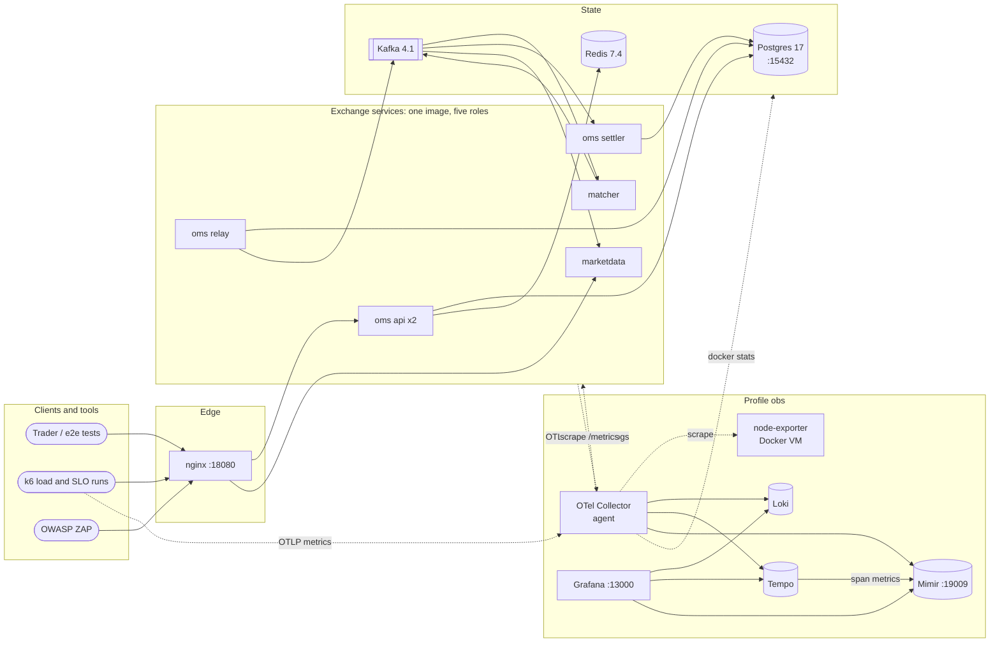
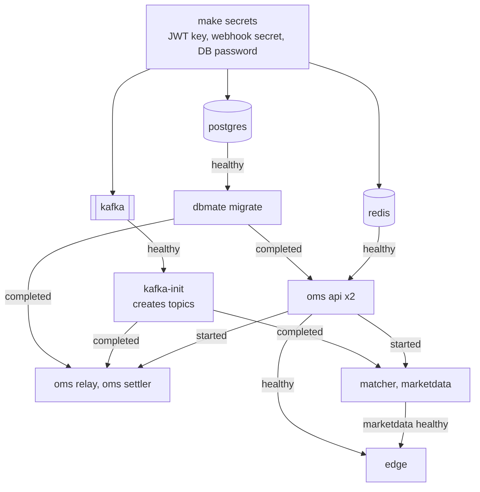
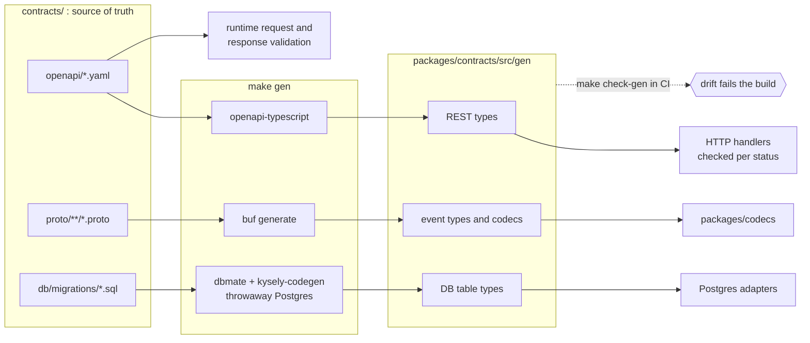
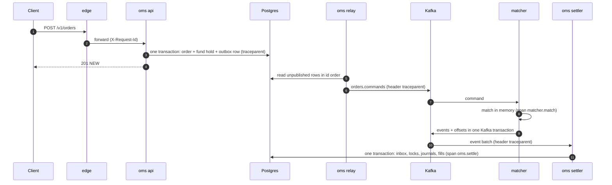
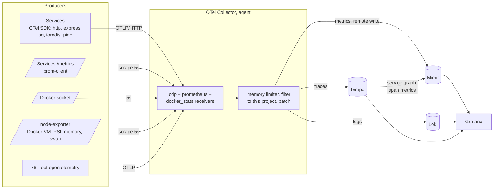
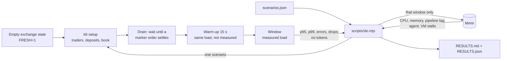

# Local development design

How the local stack is put together, how a change moves from an edit to a merged commit,
and how latency and resource use are measured. Every diagram is Mermaid: edit the text,
and GitHub renders it. Preview changes at [mermaid.live](https://mermaid.live).

## 1. Stack at a glance

One image runs every service; compose sets each one's command. The default profile is the
exchange itself. `obs` adds the telemetry pipeline, and `tools` holds one-shot runners.

| Profile | Command                 | Containers | Purpose                                            |
| ------- | ----------------------- | ---------- | -------------------------------------------------- |
| default | `make up`               | 12         | The exchange; telemetry SDK off, so CI stays light |
| `obs`   | `make up-obs`           | +6         | Collector, node-exporter, LGTM; telemetry on       |
| `tools` | `make perf`, `make slo` | k6         | Load and SLO runs inside the compose network       |

Host ports bind to `127.0.0.1` only and avoid the common defaults, so this stack can run
beside other projects.

| Container                                           | CPU limit | Memory limit |
| --------------------------------------------------- | --------: | -----------: |
| oms api (each), relay, settler, matcher, marketdata |       1.0 |      512 MiB |
| Postgres                                            |       2.0 |        1 GiB |
| Kafka                                               |       1.5 |        1 GiB |
| Tempo                                               |       1.0 |        1 GiB |
| Mimir                                               |       1.0 |      768 MiB |
| Loki                                                |       0.5 |      384 MiB |
| OTel Collector                                      |       0.5 |      256 MiB |
| node-exporter                                       |       0.2 |       64 MiB |

Tempo was OOM-killed at 384 MiB with every trace sampled at 500 req/s, then again at 1 GiB
while compacting a 100% sampled run. It now cuts blocks every minute and runs with
`GOMEMLIMIT=800MiB`, so Go collects garbage before the container limit.

## 2. Startup order

Compose starts each container once its dependencies reach the state on the arrow, and
`make up` returns only when every container is healthy.

Readiness means more than "process up": the matcher reports ready only after replaying the
command log, and marketdata only after catching up with the event log. Both costs grow with
the log: after many load runs a restart replayed 409k commands and was OOM-killed until one
attempt fit ([ADR 0003](adr/0003-matcher-log-and-recovery.md)). `make slo` therefore starts
from empty exchange state.

## 3. Contracts generate the code

## 4. From edit to commit

Every change goes through the same gates. The left half runs in seconds; the right half needs
the stack.

```mermaid
flowchart LR
  edit[Edit] --> gen[make gen<br/>if contracts changed]
  gen --> unit[make test<br/>unit + property]
  unit --> integ[make test-integration<br/>real Postgres]
  integ --> up[make up / up-obs]
  up --> e2e[make e2e]
  e2e --> chaos[make chaos]
  chaos --> sec[make security<br/>abuse + ZAP]
  sec --> perf[make slo / make ab<br/>numbers, not opinions]
  perf --> review[Review the diff<br/>against intent]
  review -->|findings| edit
  review -->|no blockers| commit[Commit]
  commit --> ci[CI: static, unit,<br/>stack job]
```

| Gate                                    | Command                                                     | Time    |
| --------------------------------------- | ----------------------------------------------------------- | ------- |
| Format, types, lint, architecture rules | `npm run format:check && npm run typecheck && npm run lint` | ~30 s   |
| Unit and property tests                 | `make test`                                                 | ~2 s    |
| Integration (testcontainers)            | `make test-integration`                                     | ~20 s   |
| E2E, chaos, abuse                       | `make e2e`, `make chaos`, `make security`                   | ~3 min  |
| SLO catalog                             | `make slo`                                                  | ~25 min |
| A/B two commits                         | `make ab A=<sha> B=<sha>`                                   | ~12 min |

## 5. One order, end to end

The W3C trace context rides the outbox row and the Kafka headers, so a single trace in
Tempo covers the whole path.

A local run shows the API at about 7 ms and order-to-settlement at about 28 ms. Most of the gap
before the matcher is the relay's poll interval.

## 6. Telemetry pipeline

- **Correlation:** log lines written while handling a traced request or event carry
  `trace_id`. Grafana links log to trace, and trace to logs and service map.
- **Cost when off:** each service command preloads `--import @exchange/platform/otel-register`.
  With `OTEL_SDK_DISABLED=true` (the default stack and CI) it imports nothing else. It is not in
  `NODE_OPTIONS`, so health check processes never load the SDK.
- **What is traced:** HTTP requests except probes, Express routes (not middleware), and
  Postgres and Redis calls only inside a traced request. The relay's idle polling is not traced.
- **Sampling:** head sampling, parent-based. `make up-obs` keeps every trace for debugging;
  `make slo` samples 10% (`SAMPLE`), as production would. Most of the cost is fixed
  instrumentation work, so tracing off would flatter the results. The A/B behind this is in
  [reports/slo/OVERHEAD.md](../reports/slo/OVERHEAD.md).
- **Cardinality:** only `container.name`, `compose_project` and `compose_service` become
  labels on container metrics.
- **Labels to trust:** panels group by the `service` label each app sets on its own metrics.
  The scrape's DNS-derived `role` label goes stale when compose reuses an IP.
- **The observers are observed:** the collector exports its own metrics (accepted, refused
  and failed per signal, queue fill, memory), and node-exporter reports how long the Docker
  VM stalled on CPU, memory and IO. A VM stall pauses every container at once, so it is the
  first thing to rule out when one window is slow.
- **Dashboards as code:** [deploy/grafana/dashboards.mjs](../deploy/grafana/dashboards.mjs)
  builds both dashboards. `make dashboards` regenerates the JSON, and `make check-gen`
  fails CI if the JSON is edited by hand, stale or not committed.

## 7. SLO tests

Scenarios live in [tests/perf/slo/scenarios.json](../tests/perf/slo/scenarios.json). Each one
states its load, window, size and objective. `make slo` runs them one at a time and writes
[reports/slo/RESULTS.md](../reports/slo/RESULTS.md).

An objective reads: _p95 ≤ X ms and p99 ≤ Y ms at the edge, over a window W, at N req/s
(or N concurrent traders) for a given size, with errors under E_. Every result is reported
with the CPU and memory of each exchange service, the state stores, the telemetry stack and
k6 itself over that window, so a latency number never travels without its cost.

A scenario counts as met only if it meets every objective and k6 dropped no iterations.
Dropped iterations mean the offered load was never sent. `make slo` exits non-zero
otherwise, and restores the normal `up-obs` stack when it ends, even on Ctrl-C.

What each scenario captures, all over the measured window only:

| Group           | Measured                                                                      | Source           |
| --------------- | ----------------------------------------------------------------------------- | ---------------- |
| Edge            | p95, p99, request rate, error rate, dropped iterations                        | k6 summary       |
| Resources       | CPU (% of one core) and memory, average and max, for every container          | Docker stats     |
| Pipeline        | p99 command to matcher, p99 to settled, max outbox backlog                    | service metrics  |
| Telemetry agent | items per second and share lost, per signal                                   | collector itself |
| Docker VM       | share of time stalled on CPU, memory and IO; swap-in; lowest available memory | node-exporter    |
| Navigation      | window start and end, with Grafana links to both dashboards for that window   | runner           |

Rules that keep runs comparable:

- **Fresh state.** Postgres and Kafka volumes are emptied first; telemetry volumes are kept.
  Load runs leave resting orders behind, and a growing book changes both latency and memory.
- **Drained setup.** Setup ends with an IOC order below every ask. It can only expire, and
  events settle in order, so its expiry means setup's own orders are settled.
- **Warm-up.** The same load runs for 15 s before the window, tagged as warm-up, so JIT,
  pools and caches are warm. Drops count only inside the window.
- **Coverage.** A window where any exchange service has under 80% of its expected samples is
  reported as incomplete, not met: a stalled collector makes averages meaningless.

## 8. Make targets

Run `make help` for the full list. The ones used daily:

| Target                                      | What it does                                          |
| ------------------------------------------- | ----------------------------------------------------- |
| `make up` / `make up-obs`                   | Start the stack, without or with telemetry            |
| `make down` / `make nuke`                   | Stop it, keeping or deleting data                     |
| `make gen` / `make check-gen`               | Regenerate code from `contracts/`, or check for drift |
| `make test` / `make test-integration`       | Unit and property tests; adapters on real Postgres    |
| `make e2e` / `make chaos` / `make security` | Suites against the running stack                      |
| `make perf` / `make slo` / `make ab`        | 500 rps load, the SLO catalog, A/B of two commits     |
