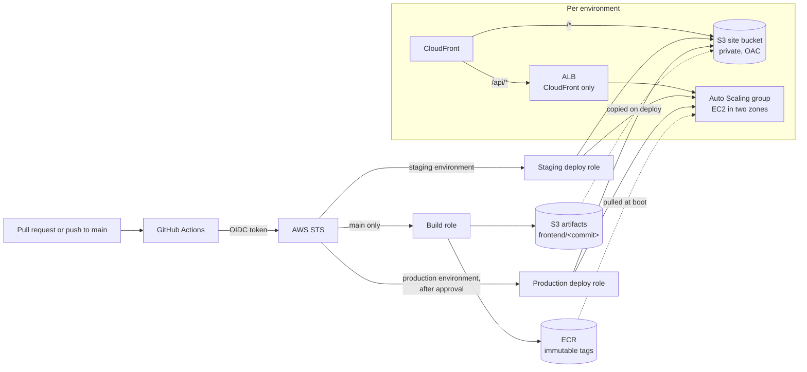
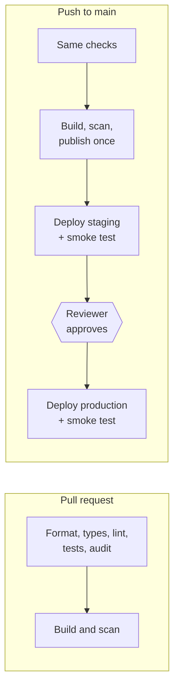

# Problem 4: Ship It Twice

Two GitHub Actions pipelines: a backend API to EC2 and a single-page app to S3. Both build
once on `main`, deploy to staging, and reach production only after a reviewer approves.
GitHub signs in to AWS with OpenID Connect, so no AWS key is stored anywhere.

Everything here runs for real: the Terraform was applied to an AWS account, and the deploys
and rollbacks in [Evidence](#evidence) were measured there.

| Piece | Where |
|---|---|
| Sample apps | [apps/backend](apps/backend) (Node 22, TypeScript), [apps/frontend](apps/frontend) (Vite) |
| Workflows | [`.github/workflows/p4-*.yml`](../../.github/workflows), at the repository root because GitHub only runs them there |
| Deploy logic | [scripts/](scripts), plain Bash that the workflows call and an operator can run |
| Infrastructure | [infra/](infra): `bootstrap` (state bucket), `shared` (OIDC, ECR, artifacts), `env` (one per environment) |
| Infrastructure tests | [infra/test](infra/test) (Terratest), [infra/policies](infra/policies) (custom Checkov policies) |

## What "production ready" means here

| Property | How the pipelines provide it |
|---|---|
| No stored cloud credentials | GitHub OIDC tokens exchanged for 1-hour AWS sessions. Each role trusts one branch or one environment. |
| Production needs a human | The `production` GitHub environment requires a reviewer, and the production deploy role trusts only jobs in that environment. |
| What was tested is what ships | The image is tagged with its commit in an immutable ECR repository; the frontend bundle is stored per commit. Staging and production deploy the same bytes. |
| No downtime | The backend launches new instances before it stops old ones. The frontend uploads hashed assets first and switches `index.html` last. |
| Bad releases never reach users | New instances join the load balancer only after the API answers on them. A release that never does is rolled back; so is one that raises 5xx or unhealthy-host alarms. |
| Any release can be restored | Run the deploy workflow by hand with an older commit. |
| Each deploy is verified | A smoke test asks CloudFront, as a user would, which version is live, and fails unless it is this commit. |
| Checks before anything ships | Format, types, lint, unit tests and dependency audit on every pull request; image scan with Trivy; Terraform fmt, validate, tflint, Checkov with custom policies, and Terratest plans; actionlint and zizmor on every workflow. |
| A hardened pipeline | Actions pinned to commit SHAs, read-only `GITHUB_TOKEN` by default, no persisted checkout credentials, inputs passed through `env`, one rollout per environment at a time. |

## Architecture



The frontend and the API share one CloudFront distribution: `/api/*` goes to the ALB and
everything else to the bucket. The SPA calls `/api/...` on its own origin, so it needs no
per-environment build and no CORS. The ALB accepts only CloudFront's address ranges and
forwards only requests carrying a secret header that CloudFront adds.

## The pipelines



Each app has its own workflow, triggered only by changes to that app, its scripts or its
workflows: `p4-backend.yml` and `p4-frontend.yml`. Both call a reusable deploy workflow per
environment (`p4-deploy-backend.yml`, `p4-deploy-frontend.yml`), which can also be run by
hand to roll back.

### Backend: an immutable rollout on EC2

The instances run the API as a container. User data installs Docker, starts the image named
by the instance's own `ImageTag` tag (read from instance metadata), and waits for the API to
answer on the instance. Only then does it release a launch lifecycle hook, so the ALB never
sees a booting or broken instance. A deploy ([deploy-backend.sh](scripts/deploy-backend.sh)):

1. Checks that the image for this commit is in ECR.
2. Creates a launch template version: Terraform's default version plus the new `ImageTag`.
3. Starts an instance refresh with auto rollback and two rollback alarms (target 5xx and
   unhealthy hosts). The group's maintenance policy keeps 100% to 200% healthy capacity, so
   new instances serve before old ones drain.
4. Watches it. Auto Scaling retries abandoned launches indefinitely, so after two of them, or
   20 minutes, the script asks AWS to roll back.
5. On success, records the live tag in SSM so a later Terraform change keeps it.

Any failure leaves the previous version serving, and the job fails.

### Frontend: assets first, `index.html` last

[deploy-frontend.sh](scripts/deploy-frontend.sh) copies the stored bundle for this commit:

1. Hashed files under `assets/` with a one-year immutable cache. Old assets are kept, so
   pages already open keep working.
2. `index.html` last, with `no-cache`. This is the switch to the new release.
3. A CloudFront invalidation of `/` and `/index.html`, then the smoke test.

### Identity: three roles, each with one caller

| Role | Who can assume it (OIDC `sub`) | What it can do |
|---|---|---|
| `p4-github-build` | `repo:<repo>:ref:refs/heads/main` | Push to the one ECR repository; write `frontend/*` in the artifact bucket |
| `p4-github-deploy-staging` | `repo:<repo>:environment:staging` | Roll the staging group; publish to the staging bucket; invalidate staging CloudFront |
| `p4-github-deploy-production` | `repo:<repo>:environment:production` | The same, for production only |
| `p4-github-plan` | `repo:<repo>:pull_request` and `main` | Read-only lookups for Terraform data sources; no state, no secrets |

`<repo>` is GitHub's immutable form, `<owner>@<owner-id>/<name>@<repo-id>`, which new
repositories send by default: a renamed or re-created repository cannot inherit the trust.

Pull requests get only the read-only plan role. A workflow on another branch cannot reach
production even if it names the production environment, because the environment accepts
`main` only (a rule that needs the GitHub plan noted under [Assumptions](#assumptions)).

## Infrastructure tests

The rules the rollout depends on are tested twice: statically on the code, then on the plan
Terraform would apply.

**Custom Checkov policies** ([infra/policies](infra/policies)) run with the built-in checks on
every change under `infra/`:

| Policy | Rule |
|---|---|
| `CKV2_P4_1` | Auto Scaling groups keep 100% healthy capacity during instance refresh |
| `CKV2_P4_2` | Launch lifecycle hooks abandon instances that never report healthy |
| `CKV2_P4_3`, `CKV2_P4_6`, `CKV2_P4_7` | Ingress comes from a security group or prefix list, never a CIDR range, whichever resource declares it |
| `CKV2_P4_4` | Load balancer listeners deny by default |
| `CKV_P4_5` | GitHub OIDC trust pins both audience and subject with exact matches |

**Terratest plan tests** ([plan_test.go](infra/test/plan_test.go)) copy each stack to a temporary
folder with local state, plan staging, production and the shared stack, and assert on the
plan JSON:

- Rollout: maintenance policy 100/200, ELB health checks, room to double capacity, two
  instances in production, the launch hook defaults to `ABANDON`, IMDSv2 with instance tags.
- Edge: no CIDR ingress (including values only known at apply), ALB only from CloudFront's
  prefix list, listener denies by default, every listener rule requires the CloudFront
  header, HTTPS on every behaviour, `/api/*` routed to the ALB, site bucket fully private.
- Identity: each deploy role trusts only its own GitHub environment.
- Shared: immutable ECR tags with scanning, versioned artifacts, the GitHub OIDC provider.
- An unknown environment name is rejected.

CI runs them on pull requests and `main` with the read-only `p4-github-plan` role. They never
read the state bucket, which holds the CloudFront origin secret.

**Terratest end-to-end test** ([e2e_test.go](infra/test/e2e_test.go)) applies a throwaway
`e2e-<id>` environment with a real image, checks it as a user would, then destroys it:

- the API answers through CloudFront with the requested version;
- plain HTTP is redirected to HTTPS;
- a direct connection to the ALB times out (its security group drops it).

It needs admin credentials, so an operator runs it (`make test-infra-e2e`).

## Evidence

Measured in `ap-southeast-1`. During each backend rollout a probe requested `/api/version`
through CloudFront every 0.5 s.

**The pipelines on GitHub Actions**, one push to `main`, every AWS call through OIDC:

| Stage | Result |
|---|---|
| Image built, scanned and published (build role) | 1 min 10 s |
| Backend to staging | Live and verified in 5 min 5 s. 843 probe requests, all 200 |
| Backend to production | Live and verified in 4 min 49 s. 924 probe requests, all 200 |
| Frontend to staging, then production | 42 s each, verified by the smoke test |
| Terratest plans (read-only plan role) | All stacks planned and checked in 7 min, mostly the AWS provider download |

Production deployed without the approval click: see [Assumptions](#assumptions) for the GitHub
plan that gate needs.

**Infrastructure tests**, run from an operator's machine:

| Test | Result |
|---|---|
| Terratest end-to-end | 41 resources applied, 3 checks passed, 41 destroyed, in 9 min 40 s |
| Custom Checkov policies | 236 checks pass on the stacks; each custom policy fails a deliberately bad example |
| Plan tests against a regression | Setting `min_healthy_percentage` to 90 fails the plan test |

**Rollout behaviour**, from the deploy scripts against staging:

| Test | Result |
|---|---|
| Good backend release | Live and verified in 4 min 23 s. 361 probe requests, all 200; old and new versions served side by side for 2.5 min, then only the new one |
| Broken image (API listens on the wrong port) | Never joined the ALB. After two abandoned launches the script rolled back; the job failed at 6 min 34 s. 554 probe requests, all 200 from the previous version |
| Frontend release | Published, invalidated and verified in 38 s |
| ALB reached directly, not through CloudFront | Connection times out: its security group admits only CloudFront |
| Viewer protocol and headers | HTTP redirects to HTTPS; HSTS, `X-Frame-Options`, `X-Content-Type-Options` and `Referrer-Policy` set; `/api/*` is `no-store` |
| App routes such as `/some/page` | Served `index.html` (200) by the CloudFront function |

## Assumptions

- **The backend is stateless and ships as a container.** "Deployed to EC2" is read as
  instances the team runs, so an Auto Scaling group behind an ALB rather than ECS.
- **The frontend has no per-environment configuration.** It calls the API on its own origin.
- **Trunk-based delivery.** `main` is releasable; staging deploys on every merge and
  production follows after approval.
- **Two environments**, `staging` and `production`, in `ap-southeast-1`.
- **No domain of our own**, so CloudFront's default certificate serves HTTPS to users.
- **One maintainer**, so the production reviewer may approve their own change.
- **Required reviewers and branch rules need a public repository or a paid GitHub plan.** On a
  private repository on GitHub Free, `make github` stops rather than create an unprotected
  production environment.

## Left out on purpose

| Item | Why, and what production would do |
|---|---|
| TLS between CloudFront and the ALB | Needs a domain for an ACM certificate. Add one and set the origin to HTTPS only. |
| Private subnets | A NAT gateway or VPC endpoints cost more than the test. Instances already accept traffic only from the ALB. |
| WAF, access logs, flow logs, KMS keys | Paid extras; each is listed with its reason in [infra/.checkov.yaml](infra/.checkov.yaml). |
| Baked AMIs | Instances install Docker at boot. A Packer image would cut instance start time. |
| Terraform apply in CI | Plans are tested in CI with a read-only role; applies run from an operator's machine. Next: apply on merge behind the production approval, then run the end-to-end test in CI. |
| Canary traffic shifting | The rollout is rolling, gated by health checks and alarms. Weighted target groups would allow a canary. |
| Signed images and provenance | GitHub attestations need Enterprise Cloud on private repositories. cosign with a KMS key is the alternative. |
| Database migrations | The sample backend has no database. They would run as a separate, approved job before the rollout. |

## Running it

```bash
export AWS_PROFILE=<admin profile>
make test                          # both apps
make lint-infra                    # fmt, validate, tflint, Checkov with custom policies
make test-infra                    # Terratest plans (read-only)
make test-infra-e2e IMAGE_TAG=<commit with an image in ECR>   # apply, test, destroy
make bootstrap shared              # once: state bucket, OIDC, ECR, artifacts
make staging production FIRST_IMAGE_TAG=<commit with an image in ECR>
make github                        # GitHub environments and variables
make destroy-env-production destroy-env-staging destroy-shared   # test accounts only
```

After that, merging to `main` deploys. To roll back, run **p4-deploy-backend** or
**p4-deploy-frontend** from the Actions tab with an older commit.
