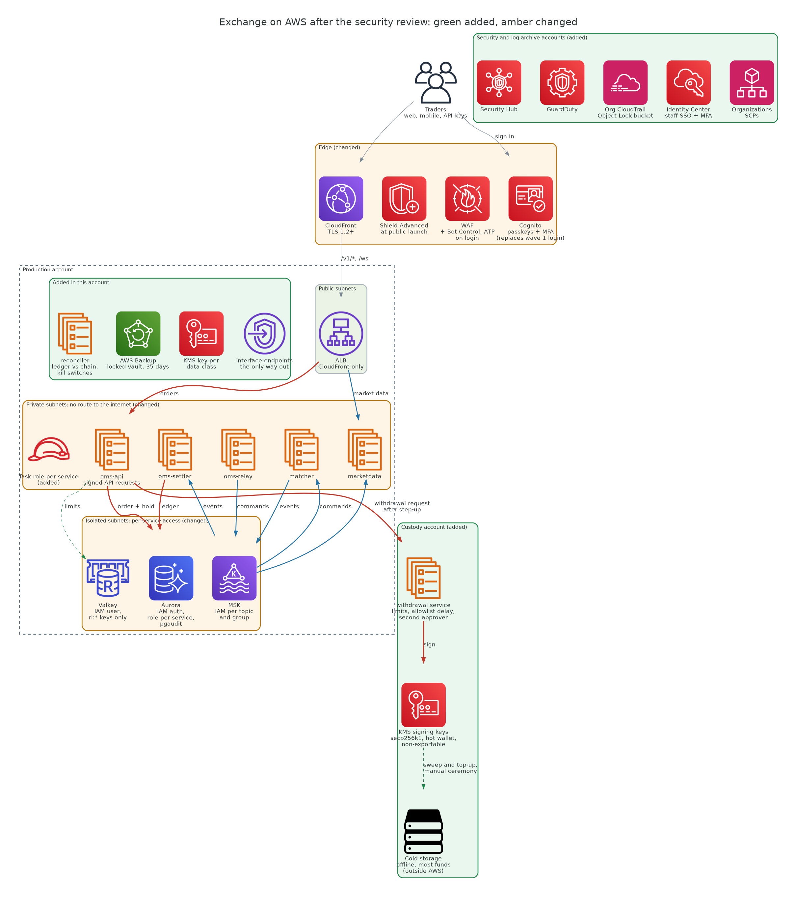

# Problem 5: Fortify the Castle

This is a security review of the [Problem 1](../problem1/SOLUTION.md) assessment tier, with
the fixes folded into the design. Each change is marked:

- **Changed:** Problem 1 had it, and it now works differently.
- **Added:** new.
- **Accepted:** the risk is left as it is, with the reason.

| Part                                                                         | State                                                                                                                                                                                                                               |
| ---------------------------------------------------------------------------- | ----------------------------------------------------------------------------------------------------------------------------------------------------------------------------------------------------------------------------------- |
| Network, data tier and per-service identity ([Terraform](../problem1/infra)) | Built and tested on a mocked AWS provider: 15 tests and 4 custom Checkov rules. 37 deliberate breaks, each caught (`make infra-breaks`). Checkov findings drop from 23 to 7, each skipped on its resource with a reason (section 6) |
| Ledger roles ([sql/roles.sql](sql/roles.sql))                                | Built and tested against Problem 1's real migrations, applied by an Aurora-style master that is not a superuser. Of 9 ledger attacks, wave 1's role gets through 6 and the service roles none (section 6)                           |
| Accounts, identity, edge, custody, detection                                 | Designed here; not built                                                                                                                                                                                                            |
| Supply chain: OIDC, pinned actions, image and dependency scans               | Already done in [Problem 4](../problem4/SOLUTION.md) and the Problem 1 CI; image signing is left out there, with the reason                                                                                                         |

## 1. The updated architecture

Green is added and amber is changed. The diagram is code
([diagrams/secure.py](diagrams/secure.py), `make diagram`).

What stays the same is worth saying too. Wave 1 already has:

- EdDSA tokens with the algorithm pinned;
- scrypt passwords with a decoy hash for unknown emails;
- per-IP, per-account and per-user limits;
- an HMAC custody webhook with a 5-minute window;
- an abuse test suite and an OWASP ZAP scan in CI
  ([ADR 0005](../problem1/docs/adr/0005-abuse-controls.md)).

Those remain.

## 2. Facts I don't have

| Unknown                                         | Why it matters                                                              | How I'd find out                             | Assumed meanwhile                                                                                           |
| ----------------------------------------------- | --------------------------------------------------------------------------- | -------------------------------------------- | ----------------------------------------------------------------------------------------------------------- |
| Jurisdiction and licence                        | Sets custody rules, record retention, breach notice and where data may live | Compliance and legal; the licence conditions | A Singapore licence that expects segregated customer assets, most of them offline, and records kept 5 years |
| Custody: in-house or a provider                 | Changes who holds keys, and so the largest part of this design              | The business; provider contracts             | In-house: a small hot wallet in AWS, everything else in offline cold storage                                |
| Team size and on-call                           | Decides between managed detection and a staffed security operations team    | Engineering leadership                       | A small team: managed services (GuardDuty, Security Hub), no in-house SIEM                                  |
| Attack history                                  | Ransom DDoS and account takeover rates set the edge spend                   | The incident log; the WAF and login metrics  | Both happen, as they do to every exchange                                                                   |
| How much is held, and what one withdrawal moves | Sets hot wallet size, withdrawal limits and the second-approver threshold   | Finance, from deposit and withdrawal history | Hot wallet below 5% of customer assets; a second approver above a fixed value per withdrawal                |

## 3. What is worth stealing or breaking

| Asset                         | Worst outcome                                    | Most likely path                                                                         | Main controls                           |
| ----------------------------- | ------------------------------------------------ | ---------------------------------------------------------------------------------------- | --------------------------------------- |
| Customer funds (signing keys) | Irreversible theft                               | Account takeover, then a withdrawal; a compromised service asking the signer; an insider | 5.6 custody, 5.2 identity, 5.1 accounts |
| Ledger integrity              | Balances that no longer match the funds held     | A compromised service rewriting journal rows; a forged deposit webhook                   | 5.4 data, 5.6 reconciliation            |
| Accounts and API keys         | Trading or withdrawing as someone else           | Credential stuffing, phishing, a leaked API key                                          | 5.2 identity                            |
| Market integrity              | Manipulated prices; insiders trading on the flow | Reading `orders.commands`; a market order sweeping a thin book                           | 5.4 per-topic access, 5.7               |
| Availability                  | Trading halted during volatility                 | Ransom DDoS; login floods                                                                | 5.3 edge                                |
| Personal data                 | Breach notice, fines, phishing material          | Database dump through a stolen credential                                                | 5.4, 5.5                                |

## 4. Priorities

### Refuse to ship without

1. **Custody in its own AWS account, behind a withdrawal policy:**
   - limits and velocity checks;
   - a delay on new addresses;
   - a second approver above a threshold;
   - a hot wallet capped at a small share of funds.

   This alone bounds what any other compromise can steal. (5.6)

2. **Continuous reconciliation of the ledger against on-chain balances, with kill switches.**
   Without it, theft or a ledger bug is found by customers. (5.6)
3. **Passkeys or TOTP for every customer, and a withdrawal lock after a credential
   change.** Account takeover is the most common way exchange users lose funds. (5.2)
4. **Separate accounts, SSO for staff, and an organisation CloudTrail that nobody can
   edit.** Every incident review starts from that trail. (5.1, 5.8)
5. **Services stop using the database owner, and each service gets only its own topics and
   keys.** The Terraform and SQL are built; the services' IAM token signers are next. (5.4, 5.5)
6. **No route from the tasks to the internet, and endpoints that serve only this account.**
   A compromised task cannot reach an outside server or another account's bucket. This is
   built. (5.3)

### Next, in this order

1. Shield Advanced and WAF Bot Control before public launch (5.3).
2. Balances derived from the journal by an owner-run trigger, so no service can update a
   balance directly; measured against settlement latency first (5.4).
3. Signed API keys with scopes, for programmatic traders (5.2).
4. Route 53 Resolver DNS Firewall, which closes DNS tunnelling (5.3).
5. Backup copies in a separate account under its own key (5.8); the in-region locked vault
   is built.
6. A price band on market orders (5.7).
7. An external penetration test, then a bug bounty.

### Deferred, with the reason

| Item                                | Why it can wait                                                                                                                    | Revisit when                                                               |
| ----------------------------------- | ---------------------------------------------------------------------------------------------------------------------------------- | -------------------------------------------------------------------------- |
| mTLS between services               | Security groups and per-service IAM already decide who talks to whom; a mesh adds latency and a control plane to run               | More services, or a zero-trust mandate                                     |
| CloudHSM                            | KMS signs secp256k1 on FIPS 140-3 Level 3 HSMs for about $1 a key. Two CloudHSMs cost $2,716 a month, more than the whole P1 stack | An auditor requires single-tenant HSMs, or a chain needs a curve KMS lacks |
| Nitro Enclaves for the policy check | The policy service already runs in its own account                                                                                 | Insider threat models require it                                           |
| A SIEM                              | GuardDuty, Security Hub and Detective cover a small team                                                                           | A staffed security operations team exists                                  |
| Bug bounty                          | It pays for findings an external test would have found cheaper                                                                     | After the first penetration test is fixed                                  |

### Accepted as they stand

| Risk                                         | Why                                                                                                                                   |
| -------------------------------------------- | ------------------------------------------------------------------------------------------------------------------------------------- |
| One region for matching                      | A region outage halts trading but loses no funds; the warm standby is the Problem 1 production tier                                   |
| Market data and orders share one MSK cluster | Per-topic IAM keeps the readers apart; a second cluster would add $594 a month                                                        |
| Rate limit counters can be wiped             | Wiping them only resets windows. Valkey accepts only oms-api, and only `rl:*` keys                                                    |
| Registration reveals that an email exists    | ADR 0005's open risk. Cognito's user-existence protection closes it at sign-in; sign-up still needs email verification to close fully |

## 5. Changes, layer by layer

### 5.1 Accounts and staff access

| Change                                                                                                                                              | Type    | Protects against                                     |
| --------------------------------------------------------------------------------------------------------------------------------------------------- | ------- | ---------------------------------------------------- |
| AWS Organizations accounts: production, staging, custody, security, log archive. Problem 1 had one account                                          | Changed | One stolen credential reaching everything            |
| SCPs: no leaving the organisation, no disabling CloudTrail, GuardDuty or Config, only two regions, no root use, no key deletion outside break-glass | Added   | An admin, or an attacker with admin, covering tracks |
| IAM Identity Center with FIDO2 keys for staff; no IAM users; read-only by default; production writes through approved, time-limited elevation       | Added   | Phished staff passwords, standing admin access       |
| Two break-glass users with hardware keys in a safe; any use pages                                                                                   | Added   | Lockout during an SSO outage, without a backdoor     |
| No direct production database access; reads go through an audited read-only role on the reader                                                      | Added   | Insiders browsing customer data                      |

### 5.2 Customer identity and API keys

| Change                                                                                                                                                                                    | Type    | Protects against                                                      |
| ----------------------------------------------------------------------------------------------------------------------------------------------------------------------------------------- | ------- | --------------------------------------------------------------------- |
| Cognito replaces wave 1's login: passkeys or TOTP required, compromised-password checks, adaptive sign-in. oms-api only verifies Cognito tokens                                           | Changed | Credential stuffing; a stolen signing key (the app no longer has one) |
| Adaptive risk instead of a hard 15-minute lockout                                                                                                                                         | Changed | ADR 0005's open risk: locking victims out on purpose                  |
| Step-up with a passkey for withdrawals, new addresses and API key creation                                                                                                                | Added   | A hijacked session withdrawing                                        |
| Withdrawals locked for 24 hours after a password, MFA, email or new-device change                                                                                                         | Added   | The usual takeover sequence: change credentials, then withdraw        |
| API keys scoped to read, trade or withdraw. Withdraw is off by default and needs an IP allowlist. Requests are signed (HMAC over method, path, body and timestamp) with a 5-second window | Added   | Leaked keys and replayed requests                                     |

### 5.3 Edge and network

| Change                                                                                                                                      | Type    | Protects against                                                                | Evidence                                 |
| ------------------------------------------------------------------------------------------------------------------------------------------- | ------- | ------------------------------------------------------------------------------- | ---------------------------------------- |
| Shield Advanced at public launch: DDoS response team, cost protection, layer 7 mitigation                                                   | Added   | Ransom DDoS during volatility                                                   | Design                                   |
| WAF Bot Control, plus account takeover prevention on the login path                                                                         | Added   | Scripted sign-ups and stuffing below the rate limits                            | Design                                   |
| NAT gateways removed. Tasks reach AWS through six interface endpoints and S3 through its gateway endpoint                                   | Changed | Exfiltration, command-and-control callbacks, SSRF reaching the internet         | `tasks_reach_aws_only_through_endpoints` |
| Workload egress only to the endpoint security group and the S3 prefix list; no address ranges                                               | Changed | The same, at the security group                                                 | Same test; Checkov rules CKV2_P1_1 to 4  |
| Endpoint policies: interface endpoints accept only this account's principals; S3 reaches only this account's buckets and ECR's layer bucket | Added   | Copying data to an attacker's bucket, or using stolen keys from another account | Same test                                |
| The VPC's default security group closed                                                                                                     | Added   | Resources accidentally launched into it talking to each other                   | `network_and_keys_are_audited`           |
| VPC flow logs for all traffic, kept a year, encrypted                                                                                       | Added   | Investigations with no network record                                           | Same test                                |

In production, removing the NAT gateways is roughly cost-neutral: the endpoints cost $171 a
month and the NAT gateways $129, and endpoint data is $0.01 per GB against NAT's $0.059. In
staging, with two zones and one NAT gateway, it adds about $70 a month.

With no NAT, two things move to deploy time:

- the collector image is mirrored into ECR;
- oms-api gets Cognito's signing keys (JWKS) from its configuration, not over the internet.

DNS queries still leave through the VPC resolver until DNS Firewall is in (next, item 4).

### 5.4 Data stores

| Change                                                                                                                                                                                       | Type    | Protects against                                                                       | Evidence                                |
| -------------------------------------------------------------------------------------------------------------------------------------------------------------------------------------------- | ------- | -------------------------------------------------------------------------------------- | --------------------------------------- |
| Services no longer connect as the table owner. The relay may touch only the outbox; oms-api and oms-settler get data access only, and nobody may update or delete journal entries            | Changed | A compromised service disabling the ledger's triggers and rewriting history            | [sql/test-roles.sh](sql/test-roles.sh)  |
| Aurora IAM authentication; each task role may connect only as its own Postgres role; the matcher not at all                                                                                  | Changed | Shared database passwords; one service using another's access                          | `each_service_gets_only_its_own_access` |
| pgaudit logs schema and role changes, plus slow statements; CloudWatch keeps a year, encrypted, and the log archive keeps 5 years                                                            | Added   | Undetected privilege or schema changes                                                 | `ledger_is_durable_and_private`         |
| MSK switches from SCRAM to IAM. The relay alone writes `orders.commands`, the matcher alone writes `matcher.events` and holds the transactional id                                           | Changed | A compromised market data task injecting orders or trades; insiders reading order flow | `each_service_gets_only_its_own_access` |
| Valkey: the shared token is replaced by an IAM-authenticated oms-api user limited to `rl:*` keys, without FLUSHALL, KEYS or other commands that ignore key patterns; the default user is off | Changed | Any VPC client reading or flushing the cache                                           | `limits_fail_over`                      |

Problem 1 already had TLS everywhere, isolated data subnets and encryption at rest. The
change is who may connect, and as whom.

**Still open:** oms-api and oms-settler update account balances, so either could change one
without a journal entry. Until balances are derived by an owner-run trigger (next, item 2),
two checks catch it:

- before signing, the withdrawal service recomputes every account of the user from the
  journal on the reader;
- an hourly job does the same for all accounts.

A mismatch blocks the withdrawal and pages.

### 5.5 Keys and secrets

| Change                                                                                                                                                                                                                                                                          | Type    | Protects against                                                                       | Evidence                                         |
| ------------------------------------------------------------------------------------------------------------------------------------------------------------------------------------------------------------------------------------------------------------------------------- | ------- | -------------------------------------------------------------------------------------- | ------------------------------------------------ |
| Customer managed keys per data class: ledger, stream and logs, each rotating yearly                                                                                                                                                                                             | Added   | One key policy or grant opening every store; CloudTrail cannot say which data was used | `network_and_keys_are_audited`                   |
| Kafka and Valkey passwords are gone, and so are their secrets and their copies in Terraform state. Aurora's master secret is rotated by RDS and used only for migrations and break-glass. The custody webhook secret remains, and so does the JWT key until Cognito replaces it | Changed | Long-lived passwords leaking from state, logs or environment variables                 | Checkov's rotation rule has nothing left to flag |
| A task role per service; ECS may assume each only from this account. Topics are created and configured only by a deploy-time admin role                                                                                                                                         | Added   | Confused deputy; one role for everything; a service changing retention                 | `each_service_gets_only_its_own_access`          |

### 5.6 Custody and withdrawals

This is the most important change. Problem 1 drew custody as a boundary; it is now its own
account, which trusts nothing from production except a request it checks again.

1. A trader asks to withdraw. oms-api requires a passkey step-up and moves the funds to
   `HELD` in the ledger.
2. It then sends the request to the withdrawal service in the custody account, through
   PrivateLink. Production holds no custody credentials.
3. The withdrawal service applies its own policy, independent of production:
   - the address has been on the user's allowlist for at least 24 hours;
   - per-user and global hourly limits, and velocity checks;
   - a second approver (staff, with a hardware key) above the threshold.
4. It signs with a KMS secp256k1 key, which cannot leave KMS, and broadcasts the
   transaction.
5. The hot wallet holds less than 5% of customer assets. Sweeps to cold storage and top-ups
   from it are offline, multi-person ceremonies.

**Reconciliation:** every 5 minutes, ledger liabilities per asset are compared with on-chain
and custody balances. Any difference above dust pages someone and halts withdrawals for
that asset automatically.

**Kill switches,** each a single audited action:

- halt all withdrawals;
- halt withdrawals for one asset;
- halt one trading pair (a matcher command);
- set the exchange to read-only.

**Deposits:** the custody webhook keeps its HMAC and 5-minute window, and is accepted only
over the PrivateLink path.

### 5.7 Market integrity

| Change                                                                                                                         | Type     | Protects against                                                        |
| ------------------------------------------------------------------------------------------------------------------------------ | -------- | ----------------------------------------------------------------------- |
| Price band in the matcher: a market order stops at a set percentage from the last trade; the rest cancels                      | Added    | ADR 0005's open risk: one market sell sweeping a thin book              |
| Kafka keeps commands and events for 7 days, enough for replay from the matcher's snapshot. The journal is the permanent record | Kept     | Disputes and manipulation investigations                                |
| Trade surveillance (wash trading, spoofing)                                                                                    | Left out | Needs a market operations team and rules; a product, not a control here |

### 5.8 Detection, audit and recovery

| Change                                                                                                                                                   | Type  | Protects against                                    | Evidence                                 |
| -------------------------------------------------------------------------------------------------------------------------------------------------------- | ----- | --------------------------------------------------- | ---------------------------------------- |
| An organisation CloudTrail goes to the log archive account, in an S3 bucket with Object Lock in compliance mode for 5 years                              | Added | Attackers deleting their trail; record retention    | Design                                   |
| GuardDuty, including RDS and ECS runtime monitoring; Security Hub with AWS best practices; AWS Config                                                    | Added | Stolen credentials in use, crypto mining, drift     | Design                                   |
| Pages for root sign-in, IAM or SCP changes, KMS key disable or deletion, security group changes on data stores, vault lock changes                       | Added | The changes an attacker makes first                 | Design                                   |
| Daily ledger backups to an AWS Backup vault with a lock: 35 days minimum, and after a 3-day grace period not even root can shorten it                    | Added | Ransomware or an insider deleting backups           | `ledger_backups_cannot_be_deleted_early` |
| Only the deploy and break-glass roles may delete, disable or re-policy a key; otherwise deleting the ledger key would make the locked backups unreadable | Added | An admin destroying backups by destroying their key | `network_and_keys_are_audited`           |
| Copies of those backups in a separate account under its own key                                                                                          | Next  | A compromised account, or region loss               | Design                                   |

## 6. Evidence

### Ledger roles: wave 1's role against the service roles

`make test-roles` builds the schema as Aurora would. A master that is not a superuser owns
the database, runs Problem 1's migrations and [roles.sql](sql/roles.sql). Each statement
then runs in a rolled-back transaction, and a refusal counts only with SQLSTATE 42501.

| Statement                                                  | Wave 1 role (`exchange`) | `oms_api`, `oms_settler` | `oms_relay` |
| ---------------------------------------------------------- | ------------------------ | ------------------------ | ----------- |
| `update` / `delete` / `truncate journal_entries`           | refused by the triggers  | refused                  | refused     |
| Disable the append-only trigger, then double every amount  | **allowed**              | refused                  | refused     |
| `set session_replication_role = replica`, then delete rows | **allowed**              | refused                  | refused     |
| `drop table journal_entries`; create a table in `public`   | **allowed**              | refused                  | refused     |
| Grant itself the owner role                                | **allowed**              | refused                  | refused     |
| Read and insert journals, lock accounts, write the outbox  | allowed                  | allowed                  | refused     |
| Use a table added by a later migration                     | allowed                  | allowed                  | refused     |
| Publish and prune the outbox, take the leader lock         | allowed                  | allowed                  | allowed     |
| Read password hashes                                       | allowed                  | allowed                  | refused     |
| Change an account balance directly                         | allowed                  | **allowed (open, 5.4)**  | refused     |

The test also checks that all three service roles can sign in with IAM (`rds_iam`).

Wave 1's triggers stop bugs, not an attacker who holds the owner's credentials, and Problem
1's design gave the services the master user. Running the full e2e suite on these roles is
the step before rollout.

### Terraform

The security diff is `git diff 147052e -- src/problem1/infra`.

| Measure                                 | Problem 1                 | After this review                                          |
| --------------------------------------- | ------------------------- | ---------------------------------------------------------- |
| Checkov findings without exceptions     | 23 from 15 rules          | 7 from 2 rules, each skipped on its resource with a reason |
| Tests on a mocked AWS provider          | 10                        | 15, plus 4 custom Checkov rules                            |
| Deliberate breaks, each caught          | 10                        | 37, rerun by `make infra-breaks` and in CI                 |
| Long-lived passwords in Terraform state | 5 (4 Kafka users, Valkey) | 0                                                          |

The two remaining rules are skipped inline:

- deletion protection, which is on unless `allow_destroy` is set and Checkov cannot
  evaluate;
- the six workload security groups, which the ECS stack attaches.

### Cost of the review

Singapore list prices from the AWS Price List API. Estimates are marked.

| Item                                                |                                              Per month |
| --------------------------------------------------- | -----------------------------------------------------: |
| Interface endpoints, minus NAT gateways             | about +$40 in production, +$70 in staging, before data |
| KMS keys (3 data, plus signing keys)                |                                    about $5 + requests |
| Shield Advanced, at public launch                   |                                                 $3,000 |
| GuardDuty, Security Hub, Config, flow logs, backups |                  low hundreds (estimate; volume-based) |
| Cognito                                             |                                per monthly active user |

Shield Advanced is the only large item. It is also the one that covers the outage an
exchange is most likely to be extorted with.

## 7. Left out, and the trade-offs

- **Application changes are designed, not built.** That covers Cognito, step-up,
  withdrawal locks, signed API keys, the price band, and the IAM token signers for Kafka,
  Postgres and Valkey. Each has a clear test: the wave 1 abuse suite gets a case per
  control.
- **The custody service is not built.** It is the largest piece of work here, and the
  in-house or provider decision (section 2) comes first.
- **Personal data beyond accounts.** Know-your-customer documents are out of Problem 1's
  scope. They would go in a separate store with its own key and field-level access logs.
- **Every control here costs latency or money.** Neither touches the order path's budget:
  - IAM tokens are signed locally and cached for their 15-minute life;
  - KMS is called on login and withdrawal, not per order;
  - the endpoints add no hop that NAT did not.
